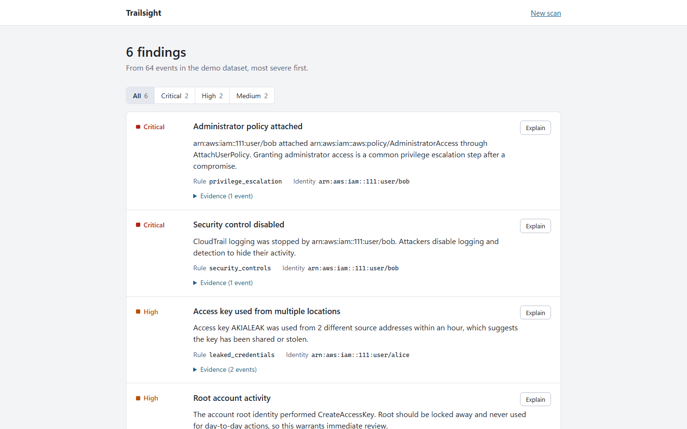
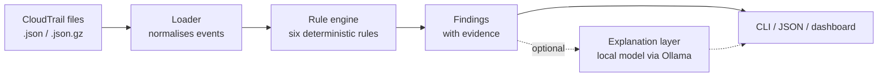

# Trailsight

Self-hostable, explainable threat detection for AWS CloudTrail.

The [case study](https://zainsplace.github.io/projects/trailsight/) covers how
the rules work, what the tests show, and what Trailsight still misses.

> Status: early development. The detection engine, the command line interface,
> the explanation layer, and the dashboard work today. Anomaly detection and
> reading logs straight from AWS are on the roadmap below.

Trailsight reads AWS CloudTrail activity and flags identity and API level
attacks that commonly hit small AWS accounts. Every finding comes with the
evidence that triggered it and a plain-English summary of why it matters. An
optional language-model layer writes fuller explanations, and it can run against
a local model.

It is free and runs entirely on your own machine. Detection is fully offline.
Explanations are optional, off by default, and with a local model through Ollama
they are offline too, so your logs never leave your machine at all.

## Why

GuardDuty is a black box, and Wiz and Datadog are priced for companies.
Trailsight is for the solo developer or small team that wants to understand what
is happening in their AWS account without paying for an enterprise platform or
handing their logs to a vendor.

## What it detects

| Rule | Fires on | ATT&CK | Labelled attacks caught |
|---|---|---|---|
| leaked_credentials | An access key, the root account or a console password used from two or more addresses within an hour | T1078.004 | 2 of 2 |
| privilege_escalation | `AdministratorAccess` attached to a user, role or group | T1098.003 | none in the test set |
| recon | 15 or more `Describe`, `List` or `Get` calls by one identity within 30 minutes | T1580, T1526 | 3 of 4 |
| security_controls | `StopLogging`, `DeleteTrail`, `DeleteDetector`, GuardDuty disassociation | T1562.008 | 2 of 2 |
| root_usage | Any root API call, grouped into one finding per day | T1078.004 | none in the test set |
| console_mfa | A successful console login without MFA by an IAM user or root | (weak authentication) | 1 of 1 |

The last column comes from the [evaluation](docs/evaluation.md) on Splunk's
public attack samples.

## What it does not detect

Trailsight covers six patterns, not AWS attacks in general. In the evaluation
it missed, by design or by gap:

- Escalation without `AdministratorAccess`: new policy versions, custom admin
  policies, `iam:PassRole` abuse
- Weakening logs without turning them off: `UpdateTrail`, deleting log
  groups, expiring the log bucket
- Persistence: new access keys, new console passwords, backdoor roles trusted
  by another account
- Data theft: public buckets, shared snapshots and AMIs, bulk downloads, bulk
  secret reads (bulk reads sometimes trip the recon rule, under the wrong name)
- Password spraying and MFA fatigue (failed logins are ignored)
- MFA for federated sign-ins, which happens at the identity provider
- Enumeration below 15 calls in 30 minutes
- Anything that needs a baseline of normal behaviour, which is on the roadmap

## Example

Input, three CloudTrail records ([docs/examples/leaked-key.json](docs/examples/leaked-key.json)):
alice's key downloads a file from one address, then from a second address
three minutes later, then grants itself administrator access.

    trailsight scan --input docs/examples/leaked-key.json

Output:

    [CRITICAL] Administrator policy attached
      rule: privilege_escalation
      identity: arn:aws:iam::111122223333:user/alice
      arn:aws:iam::111122223333:user/alice attached arn:aws:iam::aws:policy/AdministratorAccess through AttachUserPolicy. Granting administrator access is a common privilege escalation step after a compromise.

    [HIGH] Credentials used from multiple locations
      rule: leaked_credentials
      identity: arn:aws:iam::111122223333:user/alice
      Access key AKIAEXAMPLELEAK was used from 2 different source addresses within an hour, which suggests the key has been shared or stolen.

    2 findings: 1 critical, 1 high

The exit status is 1 because something was found.

## How well it works

Tested on CloudTrail I did not write: 53 labelled attack samples from
[Splunk attack_data](https://github.com/splunk/attack_data), and 1.9 million
real events from the public [flaws.cloud](https://summitroute.com/blog/2020/10/09/public_dataset_of_cloudtrail_logs_from_flaws_cloud/)
challenges. Labels were fixed before anything ran, and no rule was tuned on
this data.

| Measure | 0.1.0 | After first fixes |
|---|---|---|
| Attacks the rules claim to cover, caught by the intended rule | 6 of 9 | 8 of 9 |
| Findings on attack samples: correct / wrong / unclear | 38 / 168 / 11 | 32 / 4 / 13 |
| flaws.cloud findings: attacker / correct but authorised / wrong | 56 / 8,328 / 2,935 | 56 / 85 / 4 |
| Rules over 1.9 million events | 2.3 s | 2.7 s |

The first run showed the MFA rule firing on failed logins and federated
sessions, the leaked credentials rule missing attacks that rotate temporary
keys and firing on Lambda, and root activity reported once per API call, which
buried the real attacks. Those three are fixed. The fixed figures come from the
same data that exposed the problems, so they still need checking on fresh
data. The full method, every miss and the remaining fixes are in
[docs/evaluation.md](docs/evaluation.md).

## Quick start

No terminal needed. Install [Python](https://www.python.org/downloads/) if you
do not have it, download this project, then double-click the file for your
system:

- Windows: `start-trailsight.bat`
- macOS: `start-trailsight.command`
- Linux: `start-trailsight.sh`

The first launch sets itself up, which takes a minute and happens once. After
that the dashboard opens in your browser straight away. Upload CloudTrail files
or click "Load demo data" to see it work. Close the window to stop it.

Everything below is the command line, for people who prefer it.

## Usage

Requires Python 3.12 or newer. Install once from a clone:

    python -m pip install -e .

Generate a synthetic dataset with planted attacks, then scan it:

    trailsight generate --output demo.json
    trailsight scan --input demo.json

Scan a real CloudTrail export and get JSON output:

    trailsight scan --input your-cloudtrail.json --format json

CloudTrail delivers logs to S3 as many small `.json.gz` files. Download the
folder and point Trailsight at it; it reads every log inside, plain or gzipped,
and skips the digest files CloudTrail keeps alongside them:

    trailsight scan --input ./cloudtrail-logs/

`--input` also takes several files or folders at once. To see only what matters
most, set a minimum severity:

    trailsight scan --input ./cloudtrail-logs/ --min-severity high

A scan exits with status 1 when it finds something at or above that severity, 0
when the trail is clean, and 2 when an input cannot be read, so it can gate a
script or CI job. If the `trailsight` command is not on
your PATH, use `python -m trailsight.cli` in its place.

### Dashboard

For a visual view, install the optional dashboard and run the local server:

    python -m pip install -e ".[dashboard]"
    trailsight serve

Then open http://127.0.0.1:5000, upload one or more CloudTrail files (`.json` or
`.json.gz`) or click "Load demo data", and read the findings as severity-coloured cards. The server runs on your
machine only; nothing is uploaded anywhere.

### Explanations

Every finding already ships with the evidence that triggered it and a
plain-English summary. Explanations add a fuller account written by a language
model: what happened, why it is suspicious, and how to respond.

The model never decides what is a threat. It is only ever given a finding the
rules have already made, along with that finding's evidence, and asked to
explain it. Turn explanations off and the findings are unchanged.

Explanations are off by default and need a local model. Install
[Ollama](https://ollama.com), pull a model, then pass `--explain`:

    ollama pull llama3
    trailsight scan --input demo.json --explain

Point it at a different model or host if you need to:

    trailsight scan --input demo.json --explain --ollama-model mistral
    trailsight scan --input demo.json --explain --ollama-host http://localhost:11434

Nothing leaves your machine: the prompt goes to Ollama on localhost. In the
dashboard, each finding has an Explain button that does the same thing for that
one finding. If Ollama is not running, findings are still reported in full and
only the explanation is missing.

## Design

The model only ever sees findings the rules have already made, so switching it
off changes nothing about what is detected.

The detection pipeline and its principles are documented in
[docs/design.md](docs/design.md). In short: deterministic rules and, later,
per-identity anomaly detection do the detecting; a language model only ever
explains findings that have already been made. It never decides what is a
threat, so the tool is trustworthy with explanations switched off.

## Roadmap

- **v0.1** — CloudTrail loader, synthetic attack dataset, the six core detection
  rules, a command line interface, and an optional language-model explanation
  layer (done)
- **v0.2** — per-identity anomaly detection for novel behaviour
- **v0.3** — reading CloudTrail directly from S3 and CloudWatch
- **v0.4** — continuous monitoring in the dashboard, which currently scans a file
  at a time (the dashboard itself shipped early, in v0.1)

## Development

Requires Python 3.12 or newer.

    git clone https://github.com/zainsplace/trailsight
    cd trailsight
    python -m pip install -e . pytest ruff
    python -m ruff check src tests
    python -m pytest

## License

MIT. See [LICENSE](LICENSE).
